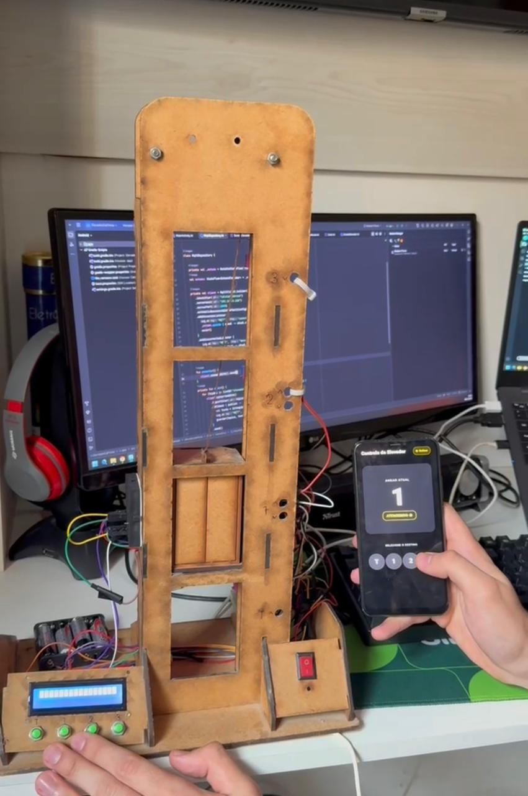
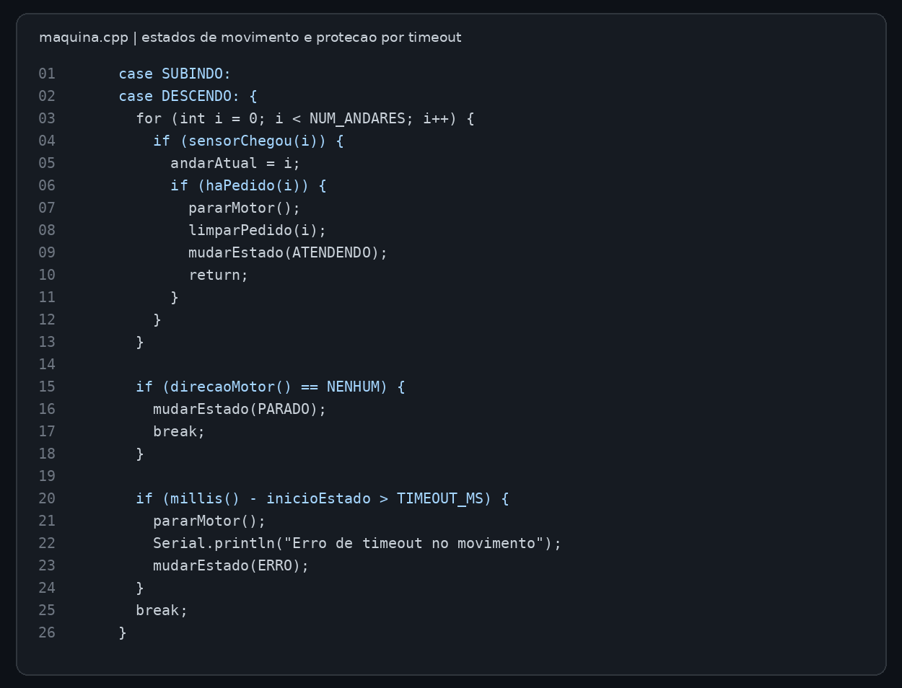
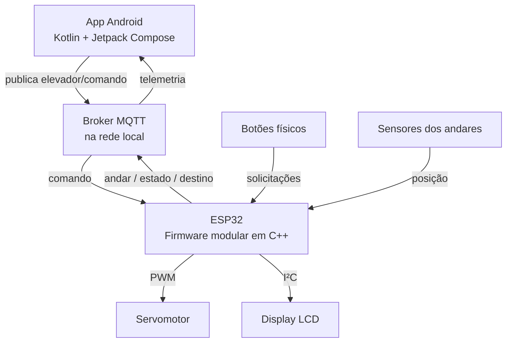
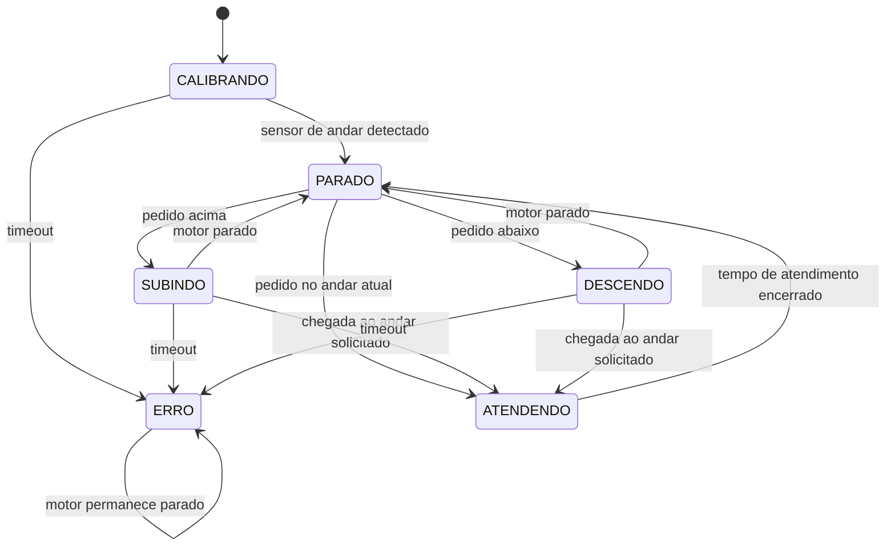

# Elevador IoT — Controle Android + ESP32 via MQTT

> Projeto acadêmico de integração entre aplicativo Android e protótipo físico de elevador, utilizando comunicação MQTT, sensores e máquina de estados no firmware.

**Tecnologias:** Kotlin · Jetpack Compose · Android · ESP32 · C++/Arduino · MQTT · Wi-Fi · Gradle

## Visão geral

O sistema permite solicitar andares pelo aplicativo Android ou por botões físicos. O ESP32 recebe os pedidos, gerencia a movimentação do motor, identifica andares por sensores e publica as informações de volta ao aplicativo. O objetivo do projeto foi aplicar conceitos de integração software–hardware em um protótipo real.

**Demonstração real:** [adicionar link do vídeo do protótipo em funcionamento].

### Registros visuais

| Aplicativo em execução | Protótipo físico |
| --- | --- |
|  |  |

**Trecho real do firmware — estados de movimento e timeout:**



> Os registros do aplicativo e do protótipo não estavam no arquivo enviado. Os espaços acima devem ser substituídos por capturas e fotos reais, sem simular evidências.

## Arquitetura



**Fluxo principal:** usuário solicita um andar → o comando chega ao broker MQTT → o ESP32 registra o pedido → a máquina de estados escolhe a direção → motor é acionado → sensores identificam a chegada → o motor para no andar solicitado → o estado atualizado é publicado e exibido no aplicativo.

### Tópicos MQTT

| Tópico | Sentido | Conteúdo |
| --- | --- | --- |
| `elevador/comando` | Android → ESP32 | Andar solicitado (`0` a `3` no app) |
| `elevador/andar` | ESP32 → Android | Andar atual |
| `elevador/estado` | ESP32 → Android | Estado da máquina |
| `elevador/destino` | ESP32 → Android | Próximo destino |
| `elevador/online` | ESP32 → broker | `online`/`offline` (mensagem de última vontade) |

O firmware publica alterações de andar, estado e destino com *retain*. O aplicativo recebe esses dados por assinatura de tópicos e atualiza sua tela por `StateFlow`. A conexão ao broker ocorre pela rede local.

## Funcionalidades implementadas

- Interface Android com seleção de andares `T`, `1`, `2` e `3`, indicação de conexão, andar atual e estado.
- Solicitação de andares tanto pelo app como por botões físicos.
- **Fila de pedidos** representada por posições pendentes em um vetor de booleanos.
- **Escolha de direção** levando em conta os pedidos acima/abaixo e a última direção.
- **Calibração inicial** baseada na leitura dos sensores de andar.
- **Máquina de estados** para controlar a sequência de movimentação.
- **Debounce de sensores** por tempo de confirmação e detecção de chegada por borda.
- **Parada nos limites** inferior e superior configurados.
- **Timeout de 15 segundos** para calibração ou deslocamento, com transição para estado `ERRO`.
- **LCD 16×2 com I²C** exibindo destino, andar e abreviação do estado.
- Reconexão MQTT com intervalo entre tentativas e bloqueio de novas tentativas enquanto o motor está em movimento.

## Lógica do firmware

O código foi dividido em módulos com responsabilidades distintas:

| Arquivo | Responsabilidade |
| --- | --- |
| `maquina.cpp` | Máquina de estados e fluxo de controle |
| `pedidos.cpp` | Registro, busca e remoção de solicitações |
| `sensores.cpp` | Leitura e estabilização dos sensores |
| `seguranca.cpp` | Parada nos limites de percurso |
| `motor.cpp` | Controle do servo por pulso |
| `mqtt_client.cpp` | Wi-Fi, comunicação e publicação de telemetria |
| `botoes.cpp` | Leitura dos botões físicos |
| `display.cpp` | Atualização do LCD |
| `config.h` | Pinos, parâmetros e temporizações |

### Máquina de estados



Os estados `CALIBRANDO`, `PARADO`, `SUBINDO`, `DESCENDO`, `ATENDENDO` e `ERRO` são encontrados em `maquina.cpp`. O estado `ATENDENDO` utiliza uma temporização configurada em 2 segundos. O nome da constante `TEMPO_PORTA_ABERTA_MS` não significa que o firmware mostrado aciona uma porta física.

Um trecho relevante do código real:

```cpp
if (millis() - inicioEstado > TIMEOUT_MS) {
  pararMotor();
  Serial.println("Erro de timeout no movimento");
  mudarEstado(ERRO);
}
```

Além do timeout, `seguranca.cpp` interrompe o motor quando os sensores dos limites configurados estão ativos. Essas proteções foram implementadas para um **protótipo acadêmico** e não representam certificação ou sistema de segurança para transporte de pessoas.

## Estrutura

```text
.
├── android-app/
│   └── ElevadorDaFirma/           # Projeto Android Studio / Gradle
├── firmware-esp32/
│   └── Elevador_MQQT_F/           # Sketch e módulos C++ do ESP32
│       ├── Elevador_MQQT_F.ino
│       ├── maquina.cpp
│       ├── pedidos.cpp
│       ├── sensores.cpp
│       ├── seguranca.cpp
│       ├── mqtt_client.cpp
│       └── secrets.example.h
├── docs/
│   └── imagens/
│       └── firmware-maquina-estados.png
└── README.md
```

## Como executar

### Firmware (ESP32)

1. Instale o suporte à placa ESP32 no Arduino IDE e as bibliotecas utilizadas pelo código: `PubSubClient`, `ESP32Servo` e `LiquidCrystal_I2C` (além do suporte Wi-Fi/Wire da plataforma).
2. Abra `firmware-esp32/Elevador_MQQT_F/Elevador_MQQT_F.ino`.
3. Copie `secrets.example.h` para `secrets.h` e configure `WIFI_SSID`, `WIFI_SENHA`, `MQTT_HOST` e `MQTT_PORTA`.
4. Confira o mapeamento dos pinos e os parâmetros de movimento em `config.h` **para o seu circuito**, antes de energizar o protótipo.
5. Configure um broker MQTT acessível ao ESP32 e ao celular na mesma rede e envie o firmware.

### Aplicativo Android

1. Abra `android-app/ElevadorDaFirma` no Android Studio e aguarde a sincronização do Gradle.
2. Altere o endereço do broker em `MqttRepository.kt` (`serverHost`) para o IP utilizado na sua rede; no código acadêmico ele está fixo como `192.168.0.228`, porta `1883`.
3. Execute em um dispositivo Android conectado à rede do broker.
4. Utilize os botões para solicitar os andares e observe a atualização do painel.

**Atenção à configuração atual:** o aplicativo exibe `T`, `1`, `2` e `3`, mas `config.h` está definido com `TERREO_HABILITADO 0`. Portanto, **pedidos do térreo (`0`) são ignorados pelo firmware nessa configuração**. Para uma demonstração consistente, use os andares 1–3 ou adapte a configuração e o circuito do térreo. O indicador “Online” do app reflete a conexão MQTT do celular, não verifica sozinho a disponibilidade do ESP32.

## Limitações e melhorias possíveis

- Parametrizar o endereço do broker no app, evitando recompilar para mudar de rede.
- Alinhar os andares habilitados na interface com a configuração real do firmware.
- Incorporar estado `elevador/online` à interface, para diferenciar broker conectado de ESP32 disponível.
- Implementar testes automatizados específicos para fila de pedidos, transições de estados e falhas.
- Documentar esquema elétrico, modelo dos sensores e fotos do protótipo.
- Evitar expor credenciais e avaliar segurança/autenticação MQTT para uso fora de rede controlada.

## Contexto e publicação

Este é um **projeto acadêmico** desenvolvido originalmente sem histórico Git. A publicação posterior no GitHub reúne os arquivos-fonte e documenta a implementação existente; não representa um histórico retroativo de desenvolvimento.

## Autoria

Projeto acadêmico- Feito por Artur Amorim

> **Aviso:** protótipo didático. Não utilizar como sistema de controle de elevadores de transporte de pessoas.
